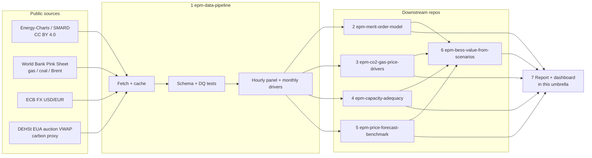

# European Power Market Lab

A multi-repo open research series on the **DE-LU** day-ahead electricity market: reproducible public data, a merit-order price model, CO₂/gas price-driver analysis, capacity / residual-load adequacy, forecast benchmarks, and BESS value under those scenarios.

> Related earlier single-repo studies (not duplicated here — linked as prior work):
> [`de-day-ahead-price-forecasting`](https://github.com/DataWithSyed/de-day-ahead-price-forecasting) ·
> [`clean-spreads-fuel-switching-de`](https://github.com/DataWithSyed/clean-spreads-fuel-switching-de) ·
> [`de-bess-reserve-revenue-stacking`](https://github.com/DataWithSyed/de-bess-reserve-revenue-stacking) ·
> [`de-wind-probabilistic-forecasting`](https://github.com/DataWithSyed/de-wind-probabilistic-forecasting) ·
> [`bess-lcos-montecarlo-irr`](https://github.com/DataWithSyed/bess-lcos-montecarlo-irr)

This series asks **different** questions: a shared lab-grade data layer, a transparent stack-based fundamental model, explicit CO₂/gas driver attribution, adequacy / scarcity metrics, a cross-model forecast bake-off that consumes the lab data, and BESS valuation **from those scenarios** (not a standalone LCOS).

## Architecture

## Roadmap

- [x] **Step 0 — Umbrella** (`eu-power-market-lab`): architecture, methods, assumptions, related work *(this repo)*
- [x] **Step 1 — Data pipeline** ([`epm-data-pipeline`](https://github.com/DataWithSyed/epm-data-pipeline)): fetch / cache / validate Energy-Charts, Pink Sheet, ECB, DEHSt EUA proxy; hourly panel + monthly drivers; pytest
- [x] **Step 2 — Merit-order model** ([`epm-merit-order-model`](https://github.com/DataWithSyed/epm-merit-order-model)): stack-based fundamental DE-LU price model vs realised DA; out-of-sample calibration study; pytest
- [x] **Step 3 — CO₂ / gas price drivers** ([`epm-co2-gas-price-drivers`](https://github.com/DataWithSyed/epm-co2-gas-price-drivers)): regression / ML attribution of DA price to fuels, carbon, residual load, and a test of the H2-2026 stack underpricing; pytest
- [x] **Step 4 — Capacity adequacy** ([`epm-capacity-adequacy`](https://github.com/DataWithSyed/epm-capacity-adequacy)): residual-load duration curves, scarcity hours, derated capacity margins, LOLE Monte Carlo screen, and a test of whether tightness explains the H2-2026 underpricing; pytest
- [x] **Step 5 — Forecast benchmark** ([`epm-price-forecast-benchmark`](https://github.com/DataWithSyed/epm-price-forecast-benchmark)): common rolling-origin harness on the lab panel, strictly ex-ante (D-1 12:00) with real TSO day-ahead forecasts; naive / stack / driver OLS / LEAR / GBM / ensemble, DM tests, H1 vs H2-2026 (links to, does not replace, `de-day-ahead-price-forecasting`); pytest
- [x] **Step 6 — BESS value from scenarios** ([`epm-bess-value-from-scenarios`](https://github.com/DataWithSyed/epm-bess-value-from-scenarios)): DE-LU 2026 day-ahead arbitrage value (1/2/4 h, daily LP, sourced ECC fee) when dispatching on, or valuing with, the step-5 forecasts and the step-2 stack worlds; H1/H2 split, block bootstrap; pytest
- [ ] **Step 7 — Final report + dashboard** (`report/` in this umbrella + lightweight dashboard repo)

## Measured results so far

| Step | Repo | Window | Headline (measured, see repo README) |
|---|---|---|---|
| 1 | [`epm-data-pipeline`](https://github.com/DataWithSyed/epm-data-pipeline) | 2026-08-01 → 2026-10-15 | 1,824 h; DA mean 140.48 €/MWh; 5.15 % negative hours; Sep gas 75.34 €/MWh_th; EUA proxy 76.02 €/t; 11 tests |
| 2 | [`epm-merit-order-model`](https://github.com/DataWithSyed/epm-merit-order-model) | train 2025, test 2026-01 → 2026-10 (16,056 h) | Uncalibrated stack test MAE 27.06 / RMSE 42.47 / corr 0.84 (beats OLS benchmark 38.61); 2025-static calibrations worse OOS (29.1–29.5); rolling 90-day recalibration MAE **22.07** (−18 %), bias −19.0 → −7.7; stack underprices H2-2026 evenings and over-predicts surplus hours (1,526 vs 497 ≤ 0 €/MWh); 17 tests |
| 3 | [`epm-co2-gas-price-drivers`](https://github.com/DataWithSyed/epm-co2-gas-price-drivers) | train 2025, test 2026-01 → 2026-10 (16,056 h) | 2025 daily Shapley R² 0.85 is almost all residual load (EUA is flat); 2026 in-sample EUA share ~8–12%. Official Q3 EUA 82.52 vs the flat 76.02 proxy closes only **7.3%** of the Jun–Oct M0 bias (−35.25 → −32.68). A 2025-trained OLS on residual load + monthly fuels beats M0 out of sample (hourly MAE **23.94** vs 27.06, nearly unbiased); gradient boosting and fuels-only OLS did **not** help. H2 residual load and utilisation *fell* while prices rose; surplus-hour share 20.4%. 11 tests |
| 4 | [`epm-capacity-adequacy`](https://github.com/DataWithSyed/epm-capacity-adequacy) | 2025-01 → 2026-10 (16,056 h) | Jun–Oct 2026 was the **loosest** period: residual load mean 22.8 GW (2025: 30.2), derated margin mean 54.3 GW / min 17.0 (2025: 46.0 / 7.9; deratings ASSUMED). Top-100 residual-load hours still averaged 326.9 €/MWh (2025: 234.5). The capacity margin explains **none** of the H2 stack gap (32.8 → 33.4 €/MWh with a margin control, CI 29.1–37.9). Jun–Oct 2025 was tighter (50.6 GW) with M0 bias −0.3, vs −35.3 in 2026. Tight hours (≤ 30 GW, 4.5 %) add only ~3 €/MWh. Isolated-zone LOLE screen ≈ 0 h at base derating (140 h in 2025 at −20 % derating, 1.2 h with 10 GW imports). Net imports in Jun–Oct fell from +2.6 to +0.08 GW. 11 tests |
| 5 | [`epm-price-forecast-benchmark`](https://github.com/DataWithSyed/epm-price-forecast-benchmark) | rolling origin, test 2026-01 → 2026-10 (304 days × 24 h) | Strictly ex-ante at D-1 12:00. Best model LEAR+GBM ensemble with neighbour load/RES forecasts and D-2 trade: MAE **14.25** €/MWh (H1 12.14 / H2 16.33) vs the best fundamental baseline, rolling stack C3, **22.67** (DM p < 1e-4; also significant in H1 and H2 separately). Naive D-1 32.78. Uncalibrated stack M0 30.42 (H2 bias −37.8). A static 2025 driver OLS **breaks** ex-ante (H2 MAE 95.3) because fuel coefficients extrapolate badly; a rolling refit repairs it (23.63). Neighbour/trade features help mainly in H2 (ensemble 17.52 → 16.33). All models degrade 33–45 % in H2, but price-lag models keep the bias at −4 to −7 €/MWh. 12 tests |
| 6 | [`epm-bess-value-from-scenarios`](https://github.com/DataWithSyed/epm-bess-value-from-scenarios) | test 2026-01 → 2026-10 (304 days); stack worlds also 2025 | 2 h perfect-foresight value 78,937 €/MW (212 €/day H1 → **306 H2**). Dispatching on the step-5 best forecast keeps **98.0 %**; naive D-1 90.5 %; rolling stack C3 only **86.9 %**, worse than naive despite a better MAE (−9.5 €/MW/day, CI −19.9…−1.5). Driver OLS rolling (MAE 23.6) keeps 97.7 %: storage value follows the intraday rank order, not the level. Valued inside its own price world, the M0 stack implies only **52 / 64 / 77 %** of realised PF value in 2025 / 2026-H1 / 2026-H2, so stack-based valuations understate arbitrage. Ranking holds across wear 0–20 €/MWh and cycle caps 1/2/none. 11 tests |

## What is different from prior repos

| Prior repo | This series instead |
|---|---|
| `de-day-ahead-price-forecasting` | Shared lab data + multi-model bake-off harness (step 5), not a single LEAR/GBM study |
| `clean-spreads-fuel-switching-de` | Full merit-order stack + driver ML (steps 2–3), not only SRMC / switching price |
| `de-bess-reserve-revenue-stacking` | BESS value **conditional on lab scenarios** (step 6), not FCR/aFRR stacking |
| `bess-lcos-montecarlo-irr` | Scenario revenues from steps 2–5, not synthetic LCOS |

## Methods and assumptions

- [`docs/methods.md`](docs/methods.md) — DOI-verified literature anchors (Crossref)
- [`docs/assumptions.md`](docs/assumptions.md) — labelled ASSUMED factors and data proxies
- [`docs/related-work.md`](docs/related-work.md) — prior DataWithSyed repos this series builds beside

## Licence

MIT for code and documentation in this umbrella. Upstream data keep their own licences (CC BY 4.0 Energy-Charts / SMARD / World Bank; ECB; DEHSt public auction figures). Always attribute.
