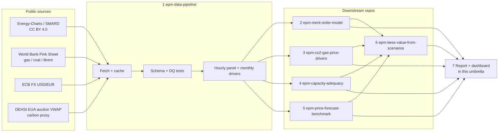

# European Power Market Lab

A multi-repo open research series on the **DE-LU** day-ahead electricity market: reproducible public data, a merit-order price model, CO₂/gas price-driver analysis, capacity / residual-load adequacy, forecast benchmarks, and BESS value under those scenarios.

> Related earlier single-repo studies (not duplicated here — linked as prior work):
> [`de-day-ahead-price-forecasting`](https://github.com/DataWithSyed/de-day-ahead-price-forecasting) ·
> [`clean-spreads-fuel-switching-de`](https://github.com/DataWithSyed/clean-spreads-fuel-switching-de) ·
> [`de-bess-reserve-revenue-stacking`](https://github.com/DataWithSyed/de-bess-reserve-revenue-stacking) ·
> [`de-wind-probabilistic-forecasting`](https://github.com/DataWithSyed/de-wind-probabilistic-forecasting) ·
> [`bess-lcos-montecarlo-irr`](https://github.com/DataWithSyed/bess-lcos-montecarlo-irr)

This series asks **different** questions: a shared lab-grade data layer, a transparent stack-based fundamental model, explicit CO₂/gas driver attribution, adequacy / scarcity metrics, a cross-model forecast bake-off that consumes the lab data, and BESS valuation **from those scenarios** (not a standalone LCOS).

## Architecture

## Roadmap

- [x] **Step 0 — Umbrella** (`eu-power-market-lab`): architecture, methods, assumptions, related work *(this repo)*
- [x] **Step 1 — Data pipeline** ([`epm-data-pipeline`](https://github.com/DataWithSyed/epm-data-pipeline)): fetch / cache / validate Energy-Charts, Pink Sheet, ECB, DEHSt EUA proxy; hourly panel + monthly drivers; pytest
- [x] **Step 2 — Merit-order model** ([`epm-merit-order-model`](https://github.com/DataWithSyed/epm-merit-order-model)): stack-based fundamental DE-LU price model vs realised DA; out-of-sample calibration study; pytest
- [x] **Step 3 — CO₂ / gas price drivers** ([`epm-co2-gas-price-drivers`](https://github.com/DataWithSyed/epm-co2-gas-price-drivers)): regression / ML attribution of DA price to fuels, carbon, residual load, and a test of the H2-2026 stack underpricing; pytest
- [ ] **Step 4 — Capacity adequacy** (`epm-capacity-adequacy`): residual load, scarcity hours, capacity margins
- [ ] **Step 5 — Forecast benchmark** (`epm-price-forecast-benchmark`): common backtest harness on the lab panel (links to, does not replace, `de-day-ahead-price-forecasting`)
- [ ] **Step 6 — BESS value from scenarios** (`epm-bess-value-from-scenarios`): arbitrage / scarcity value under model and forecast scenarios
- [ ] **Step 7 — Final report + dashboard** (`report/` in this umbrella + lightweight dashboard repo)

## Measured results so far

| Step | Repo | Window | Headline (measured, see repo README) |
|---|---|---|---|
| 1 | [`epm-data-pipeline`](https://github.com/DataWithSyed/epm-data-pipeline) | 2026-08-01 → 2026-10-15 | 1,824 h; DA mean 140.48 €/MWh; 5.15 % negative hours; Sep gas 75.34 €/MWh_th; EUA proxy 76.02 €/t; 11 tests |
| 2 | [`epm-merit-order-model`](https://github.com/DataWithSyed/epm-merit-order-model) | train 2025, test 2026-01 → 2026-10 (16,056 h) | Uncalibrated stack test MAE 27.06 / RMSE 42.47 / corr 0.84 (beats OLS benchmark 38.61); 2025-static calibrations worse OOS (29.1–29.5); rolling 90-day recalibration MAE **22.07** (−18 %), bias −19.0 → −7.7; stack underprices H2-2026 evenings and over-predicts surplus hours (1,526 vs 497 ≤ 0 €/MWh); 17 tests |
| 3 | [`epm-co2-gas-price-drivers`](https://github.com/DataWithSyed/epm-co2-gas-price-drivers) | train 2025, test 2026-01 → 2026-10 (16,056 h) | 2025 daily Shapley R² 0.85 is almost all residual load (EUA is flat); 2026 in-sample EUA share ~8–12%. Official Q3 EUA 82.52 vs the flat 76.02 proxy closes only **7.3%** of the Jun–Oct M0 bias (−35.25 → −32.68). A 2025-trained OLS on residual load + monthly fuels beats M0 out of sample (hourly MAE **23.94** vs 27.06, nearly unbiased); gradient boosting and fuels-only OLS did **not** help. H2 residual load and utilisation *fell* while prices rose; surplus-hour share 20.4%. 11 tests |

## What is different from prior repos

| Prior repo | This series instead |
|---|---|
| `de-day-ahead-price-forecasting` | Shared lab data + multi-model bake-off harness (step 5), not a single LEAR/GBM study |
| `clean-spreads-fuel-switching-de` | Full merit-order stack + driver ML (steps 2–3), not only SRMC / switching price |
| `de-bess-reserve-revenue-stacking` | BESS value **conditional on lab scenarios** (step 6), not FCR/aFRR stacking |
| `bess-lcos-montecarlo-irr` | Scenario revenues from steps 2–5, not synthetic LCOS |

## Methods and assumptions

- [`docs/methods.md`](docs/methods.md) — DOI-verified literature anchors (Crossref)
- [`docs/assumptions.md`](docs/assumptions.md) — labelled ASSUMED factors and data proxies
- [`docs/related-work.md`](docs/related-work.md) — prior DataWithSyed repos this series builds beside

## Licence

MIT for code and documentation in this umbrella. Upstream data keep their own licences (CC BY 4.0 Energy-Charts / SMARD / World Bank; ECB; DEHSt public auction figures). Always attribute.
