# European Power Market Lab — final report (step 7)

**Series status: COMPLETE (17 Nov 2026).** Seven public repos study the DE-LU day-ahead market from January 2025 to October 2026. They share one data layer and go through a merit-order model, CO₂/gas drivers, adequacy, a forecast benchmark and battery (BESS) value. This report puts their results together. Every number below is copied from a committed step output. `results/key_numbers.json` maps each headline number to its source file and field, and `tests/test_report.py` fails if the text and the outputs disagree. Nothing is re-estimated here.

> Historical backtests on public data. Paper analysis only, not trading advice. Labelled **ASSUMED** inputs are assumptions, not observations.

## 1. Summary

1. **A transparent stack model explains most of the price level but misses the regime shift.** The uncalibrated 5-technology stack (step 2) has a test MAE of 27.06 €/MWh (corr 0.84, bias −18.96) on Jan–Oct 2026. A rolling 90-day recalibration (C3) brings that to 22.07 (bias −7.65).
2. **From June 2026 the stack underprices by about 35 €/MWh, and none of the obvious fundamentals explain it.** The carbon-price gap closes 7.3 % of it (step 3). The capacity margin explains none of it: the system was *looser* in H2 2026 than in 2025 (step 4).
3. **Statistical forecasts beat the stack by a wide margin.** Strictly ex-ante (D-1 12:00), the best LEAR+GBM ensemble with neighbour features reaches MAE 14.25 €/MWh vs 22.67 for the rolling stack (step 5; DM p < 1e-4).
4. **For storage, the intraday shape matters more than the level.** A 2 h battery dispatched on the best forecast keeps 98.0 % of perfect-foresight value. The rolling stack keeps only 86.9 %, which is worse than a naive D-1 forecast (90.5 %) despite a much better MAE (step 6).

## 2. Method chain

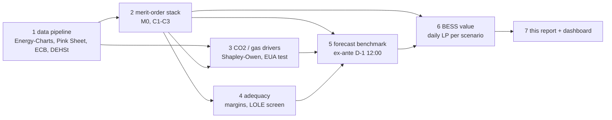

| Step | Repo | Question | Method | Window |
|---|---|---|---|---|
| 1 | [`epm-data-pipeline`](https://github.com/DataWithSyed/epm-data-pipeline) | Can the lab be built from licence-clean public data? | Fetch, cache, schema and DQ tests; hourly panel + monthly drivers | 2026-08-01 → 2026-10-15 (smoke window) |
| 2 | [`epm-merit-order-model`](https://github.com/DataWithSyed/epm-merit-order-model) | How far does a transparent stack get? | 5 techs × 10 ASSUMED efficiency bands, IPCC 2006 CO₂ factors, isolated zone; calibration variants | train 2025, test 2026-01..10 |
| 3 | [`epm-co2-gas-price-drivers`](https://github.com/DataWithSyed/epm-co2-gas-price-drivers) | What drives the price, and is H2 a carbon story? | Shapley-Owen R² attribution, OLS/HGB out of sample, first-order EUA adjustment with official DEHSt quarterly VWAPs | same |
| 4 | [`epm-capacity-adequacy`](https://github.com/DataWithSyed/epm-capacity-adequacy) | Was H2 2026 a scarcity story? | Residual-load duration, derated margins (ASSUMED deratings), margin-controlled gap regression, LOLE Monte Carlo screen | 2025-01 → 2026-10 |
| 5 | [`epm-price-forecast-benchmark`](https://github.com/DataWithSyed/epm-price-forecast-benchmark) | Which forecast is best ex-ante? | Rolling origin, real TSO D-1 forecasts for DE + 8 neighbours; naive / stack / driver OLS / LEAR / GBM / ensembles; DM tests | test 2026-01..10, 304 d |
| 6 | [`epm-bess-value-from-scenarios`](https://github.com/DataWithSyed/epm-bess-value-from-scenarios) | What is each price scenario worth to a battery? | Daily LP (1/2/4 h, RTE 0.88 ASSUMED, 1 cycle/day ASSUMED, ECC fee 0.015 €/MWh sourced, wear 5 €/MWh ASSUMED); dispatch on scenario, settle at realised DA; block bootstrap | same |

Data reuse is explicit. The step-2 processed panel is reused byte for byte in steps 3–5, and step 6 consumes the step-2 model prices and the step-5 forecasts. Each repo ships the derived files it needs. Raw API payloads are git-ignored.

## 3. Results by step

Figures prefixed `S2`–`S6` are unchanged copies of the figures committed in the step repos, at the commits in [`data/SOURCES.md`](data/SOURCES.md). Figures `R1` and `R2` are built here by `scripts/build_report.py` from the snapshot files.

### Step 1 — data pipeline

Smoke window of 1,824 hourly rows: DA mean 140.48 €/MWh, 5.15 % negative-price hours. September 2026 gas was 75.34 €/MWh_th (Pink Sheet, ASSUMED MMBtu→MWh conversion). The EUA proxy is 76.02 €/t (DEHSt H1-2026 auction VWAP, a proxy rather than a futures price). 11 tests.

### Step 2 — merit-order model

| Variant (test 2026-01..10) | MAE €/MWh | Bias €/MWh |
|---|---:|---:|
| M0 uncalibrated stack | 27.06 | −18.96 |
| C2 structural grid calibrated on 2025 | 29.12 | — |
| **C3 rolling 90-day recalibration** | **22.07** | −7.65 |
| B2 OLS on residual load + SRMC (benchmark) | 38.61 | — |

Static 2025 calibrations get *worse* out of sample, and only rolling recalibration helps. The stack predicts 1,526 hours at or below 0 €/MWh against 497 realised, because the isolated-zone design ignores exports. Its errors are largest in the evening hours.

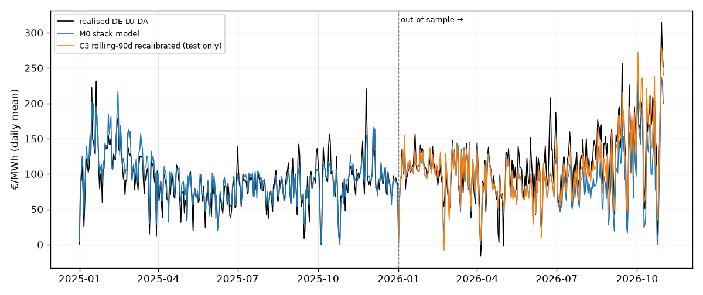
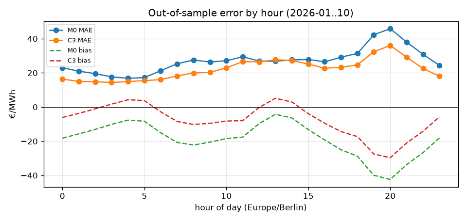

### Step 3 — CO₂ / gas drivers

In 2025 the daily Shapley-Owen R² is almost entirely residual load, because the official EUA series is a flat annual VWAP and so carbon cannot be identified. In Jan–Oct 2026 the official quarterly VWAPs (75.95 / 76.12 / 82.52 €/t) let carbon take 0.08 of the 0.81 in-sample daily R². The first-order Q3 carbon adjustment moves the H2 M0 bias from −35.25 to −32.68 €/MWh, closing 2.57 €/MWh (7.3 %). Gradient boosting and a fuels-only OLS did **not** help out of sample.

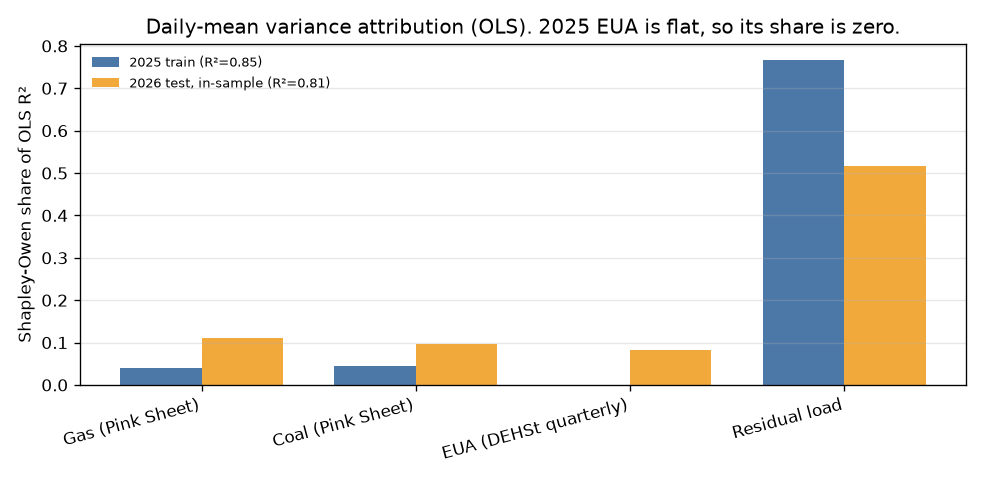
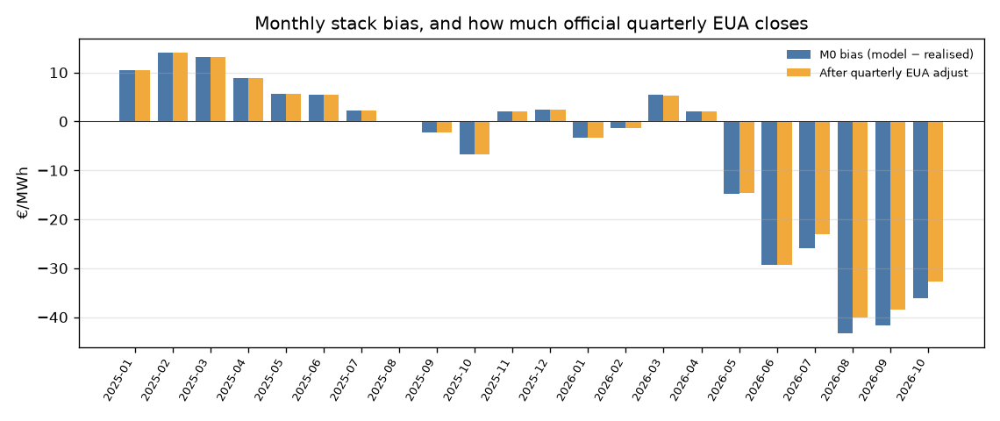

### Step 4 — capacity adequacy

Derated margin (ASSUMED deratings) averaged 54.3 GW in H2 2026 vs 46.0 GW in 2025. Even so, the 100 highest residual-load hours averaged 326.9 €/MWh in H2 2026 vs 234.5 in 2025. Adding a margin control moves the H2 gap from 32.8 to 33.4 €/MWh, so the margin explains none of it. Jun–Oct 2025 had an M0 bias of −0.3 €/MWh. The isolated-zone LOLE screen is ≈ 0 h at base derating.

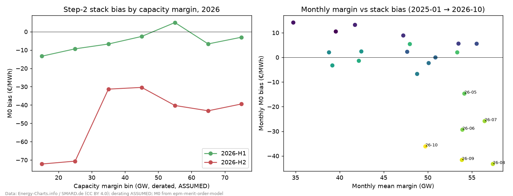
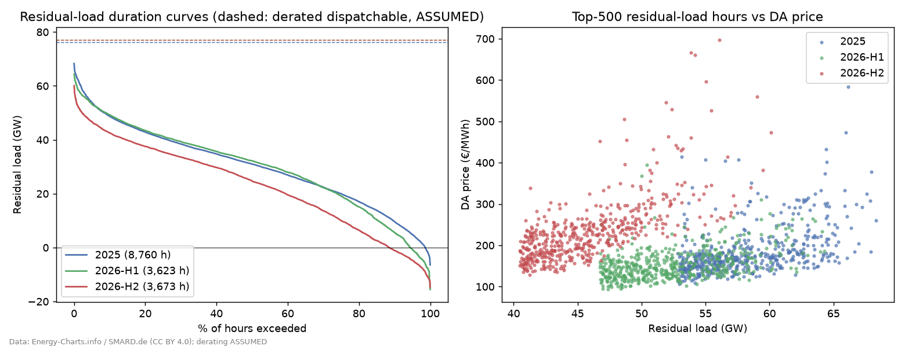

### Step 5 — forecast benchmark

| Ex-ante model (test 2026-01..10) | MAE €/MWh |
|---|---:|
| Naive D-1 | 32.78 |
| Stack M0 ex-ante | 30.42 |
| Driver OLS, rolling refit | 23.63 |
| Stack C3 rolling (best fundamental baseline) | 22.67 |
| **LEAR+GBM ensemble + neighbour features (ens_nb)** | **14.25** (H1 12.14 / H2 16.33) |

ens_nb beats C3 significantly (DM p < 1e-4, also within H1 and H2 separately). A static 2025 driver OLS breaks down in H2 (MAE 95.3) because its fuel coefficients extrapolate badly. Using realised instead of forecast load and RES (ORACLE) does not improve LEAR.

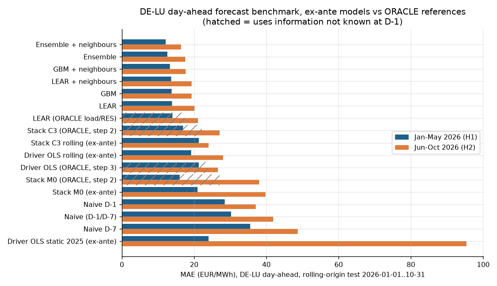

### Step 6 — BESS value from scenarios

The 2 h perfect-foresight value is 78,937 €/MW over 304 days. Mean daily value rises from 212 €/MW/day in H1 to 306 in H2.

| Dispatch signal (2 h, ex-ante) | % of perfect-foresight value |
|---|---:|
| ens_nb (best forecast) | 98.0 |
| Driver OLS rolling | 97.7 |
| Naive D-1 | 90.5 |
| Stack C3 ex-ante | 86.9 |
| Stack M0 ex-ante | 83.6 |

ens_nb − C3: +29.0 €/MW/day. C3 − naive: −9.5 €/MW/day (90 % CI −19.9 … −1.5). The stack is worse than naive for dispatch, an honest negative. Across the ex-ante models, retained value tracks the daily rank correlation (Spearman 0.80) more closely than MAE (Spearman −0.73).

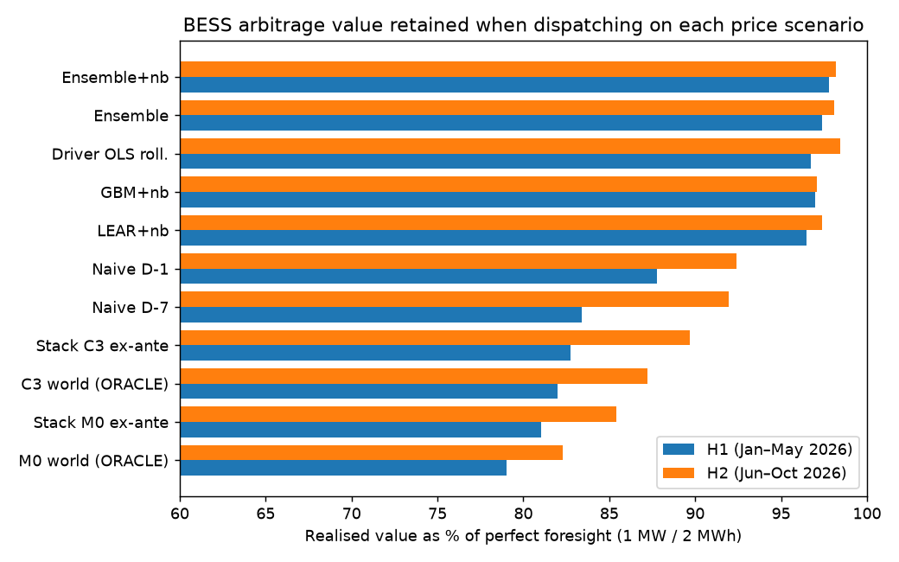
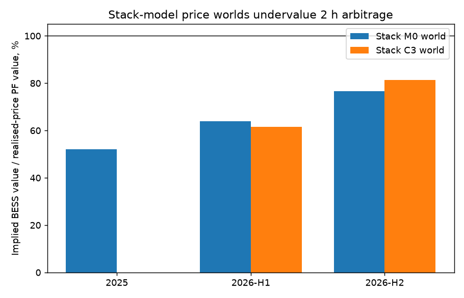
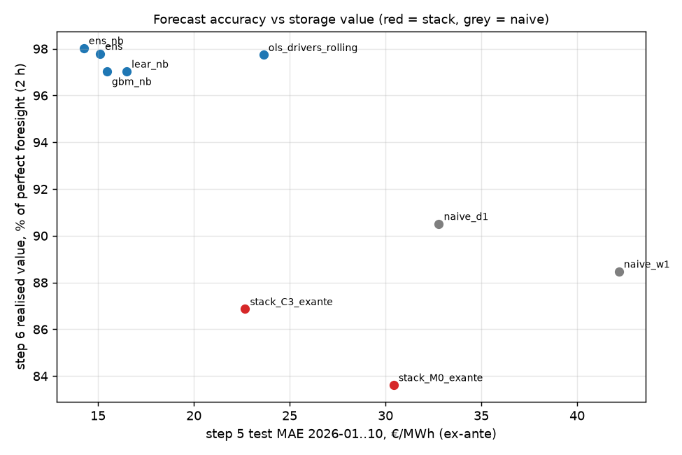

## 4. The H2-2026 stack-underpricing narrative (steps 2–6)

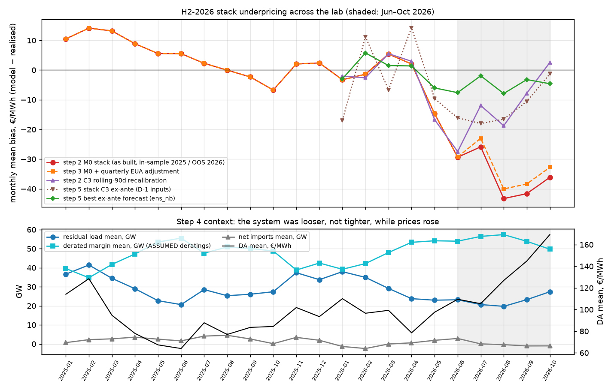

*Figure R1 (built here from the step outputs).* Top: monthly bias of each stack variant and of the best ex-ante forecast. Bottom: step-4 context.

- **Step 2 finds it.** M0 tracks 2025 and early 2026 but underprices from June 2026, worst in the evening hours. Rolling recalibration (C3) shrinks the bias but does not remove it: its monthly bias is still −27.46 €/MWh in June and −18.75 in August 2026.
- **Step 3 rules out carbon.** Jun–Oct 2026 M0 bias is −35.25 €/MWh. The official Q3 EUA increment explains 2.57 €/MWh (7.3 %). Meanwhile mean residual load *fell* from 29.7 GW (H1) to 22.8 GW (H2) while DA rose from 96.5 to 131.3 €/MWh. The stack's surplus-hour share rose to 20.4 % (2025: 7.2 %). The in-sample price slope on residual load steepened from 2.91 to 4.23 €/MWh per GW.
- **Step 4 rules out scarcity.** H2 2026 was the loosest period (margin 54.3 GW), and the gap survives a margin control (32.8 → 33.4 €/MWh). The one large difference from Jun–Oct 2025 (bias −0.3) is trade. Net imports fell from 2.6 GW to 0.08 GW, and DE-LU was a net exporter from August to October 2026. This is consistent with an isolated-zone stack missing export-driven price coupling. It is a lead, not a proven cause. The step-2 trade-exogenous variant narrows the H2 bias but worsens MAE, because trade is itself price-endogenous.
- **Step 5 shows that price-lag models adapt.** Every model degrades in H2, but models that see recent prices and neighbour forecasts keep a small bias. ens_nb has MAE 16.33 in H2, while ex-ante M0 has an H2 bias of −37.8. Neighbour and trade features help mainly in H2.
- **Step 6 prices the consequence.** A stack that misses the level and the evening shape also misplaces dispatch. C3 keeps 86.9 % of PF value against 98.0 % for ens_nb. Valued inside its own price world, the M0 stack implies only 52 / 64 / 77 % of the realised PF value (2025 / 2026-H1 / 2026-H2), so stack-world valuations understate arbitrage.

**Conclusion.** The H2-2026 underpricing is not a carbon, fuel-level or adequacy effect in this lab's data. The leading explanation is cross-border coupling: an isolated-zone stack cannot see neighbours setting the DE-LU price while Germany exports. A coupled multi-zone stack would be needed to test this properly.

## 5. Limitations

- One market (DE-LU), about 22 months, and one regime shift. No inference beyond this sample.
- Fuels are monthly (World Bank Pink Sheet). No licence-clean daily TTF / API2 / EUA futures source was used, and carbon is official DEHSt auction VWAPs. The October 2026 EUA value is a carried proxy.
- Stack efficiencies, availabilities, VOM and deratings are ASSUMED (see each repo's `docs/assumptions.md`). The stack is an isolated zone with no flow-based coupling.
- The LOLE screen is an isolated-zone screen, not an adequacy assessment.
- BESS results are for a price-taking 1 MW battery in the day-ahead market only. There is no intraday, no balancing (see the separate reserve-stacking repo) and no grid fees. RTE, cycle cap and wear are ASSUMED. Annualised figures are labelled scalings of a 304-day window.
- The step-1 smoke window (Aug–Oct 2026) is a pipeline check, not an analysis period.

## 6. Dashboard

`dashboard/app.py` is a lightweight Streamlit view of the same committed outputs (headline metrics, H2 bias vs context, step-5 tables, step-6 retained value). It does no fetching and no estimation.

```bash
pip install -r requirements.txt
python report/scripts/build_report.py      # rebuild key_numbers.json + figures R1/R2 from report/data
streamlit run report/dashboard/app.py
python -m pytest -q report/tests           # number cross-check, snapshot hashes, figures, dashboard smoke test
```

## 7. References

DOIs as cited and Crossref-checked in the step repos and in the umbrella's [`docs/methods.md`](../docs/methods.md).

- Sensfuß, F., Ragwitz, M., Genoese, M. (2008). The merit-order effect. *Energy Policy*. [10.1016/j.enpol.2008.03.035](https://doi.org/10.1016/j.enpol.2008.03.035)
- Hirth, L. (2013). The market value of variable renewables. *Energy Economics*. [10.1016/j.eneco.2013.02.004](https://doi.org/10.1016/j.eneco.2013.02.004)
- Schill, W.-P. (2014). Residual load, renewable surplus generation and storage requirements in Germany. *Energy Policy*. [10.1016/j.enpol.2014.05.032](https://doi.org/10.1016/j.enpol.2014.05.032)
- Garver, L. L. (1966). Effective Load Carrying Capability of Generating Units. *IEEE Trans. Power Apparatus and Systems* PAS-85(8). [10.1109/TPAS.1966.291652](https://doi.org/10.1109/TPAS.1966.291652)
- Weron, R. (2014). Electricity price forecasting: a review of the state-of-the-art. *Int. J. Forecasting*. [10.1016/j.ijforecast.2014.08.008](https://doi.org/10.1016/j.ijforecast.2014.08.008)
- Lago, J., Marcjasz, G., De Schutter, B., Weron, R. (2021). Forecasting day-ahead electricity prices: a review of state-of-the-art algorithms, best practices and an open-access benchmark. *Applied Energy* 293. [10.1016/j.apenergy.2021.116983](https://doi.org/10.1016/j.apenergy.2021.116983)
- Uniejewski, B., Weron, R., Ziel, F. (2018). Variance stabilizing transformations for electricity spot price forecasting. *IEEE Trans. Power Systems*. [10.1109/TPWRS.2017.2734563](https://doi.org/10.1109/TPWRS.2017.2734563)
- Diebold, F. X., Mariano, R. S. (1995). Comparing predictive accuracy. *J. Business & Economic Statistics*. [10.1080/07350015.1995.10524599](https://doi.org/10.1080/07350015.1995.10524599)
- Künsch, H. R. (1989). The jackknife and the bootstrap for general stationary observations. *Annals of Statistics* 17(3). [10.1214/aos/1176347265](https://doi.org/10.1214/aos/1176347265)
- IPCC (2006). *Guidelines for National Greenhouse Gas Inventories*, Vol. 2 Energy, Ch. 2, Table 2.2 (default CO₂ factors).
- Data: Energy-Charts (Fraunhofer ISE) / Bundesnetzagentur | SMARD.de (CC BY 4.0); World Bank Pink Sheet (CC BY 4.0); ECB euro reference rates; DEHSt auction reports.

Snapshot provenance (repo commits and SHA-256 of every file used): [`data/SOURCES.md`](data/SOURCES.md).
